  <picture>
    <source media="(prefers-color-scheme: dark) and (min-width: 768px)" srcset="assets/header-wide-dark.svg" />
    <source media="(min-width: 768px)" srcset="assets/header-wide-light.svg" />
    <source media="(prefers-color-scheme: dark)" srcset="assets/header-dark.svg" />
    
  </picture>

  <a href="https://spotify-github-profile.kittinanx.com/api/view?uid=u1yq4j794rlp4b9q6je077ls5&redirect=true">
    <picture>
      <source media="(prefers-color-scheme: dark)" srcset="https://spotify-github-profile.kittinanx.com/api/view?uid=u1yq4j794rlp4b9q6je077ls5&theme=spotify-embed&cover_image=true&show_offline=false&border_radius=11&mode=dark" />
      
    </picture>
  </a>

  
  
  
  
  

  <picture>
    <source media="(prefers-color-scheme: dark) and (min-width: 768px)" srcset="assets/cards-wide-dark.svg" />
    <source media="(min-width: 768px)" srcset="assets/cards-wide-light.svg" />
    <source media="(prefers-color-scheme: dark)" srcset="assets/cards-stack-dark.svg" />
    
  </picture>

